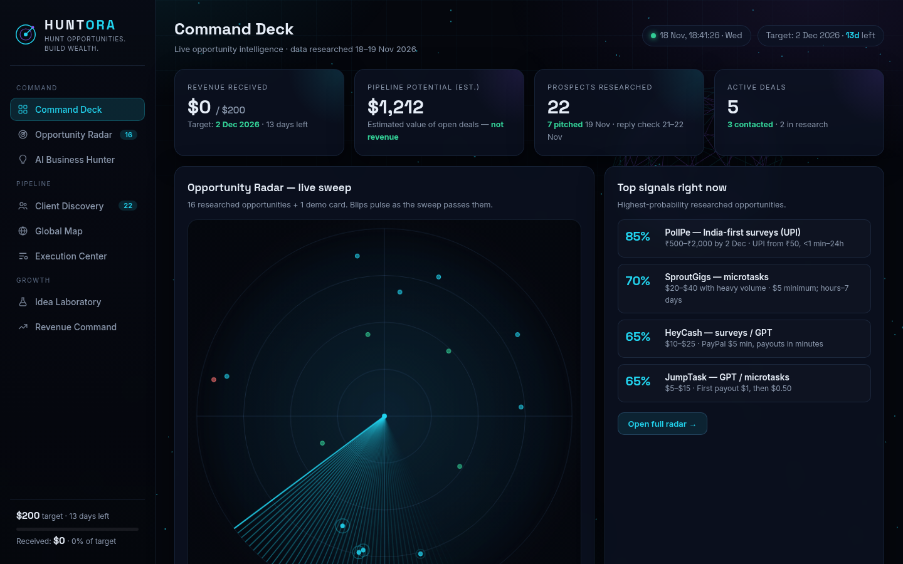
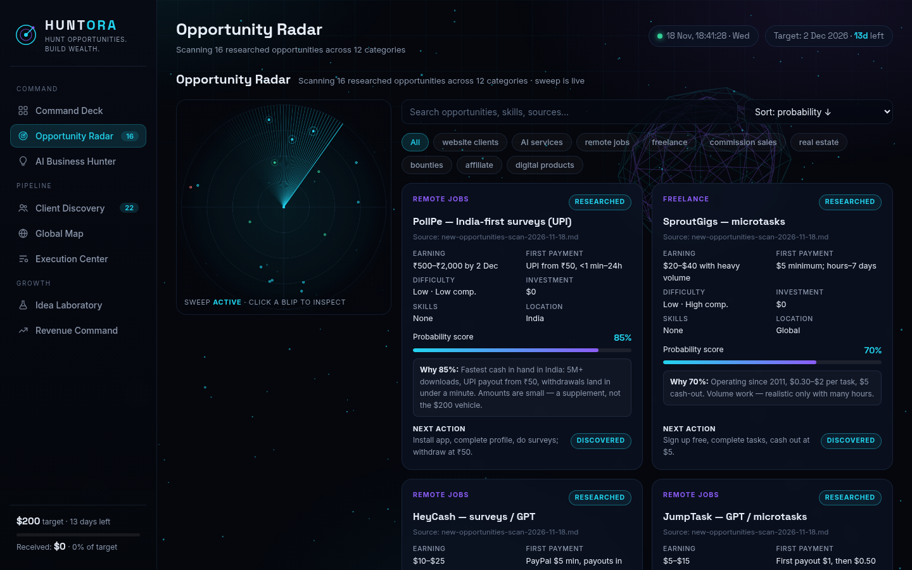
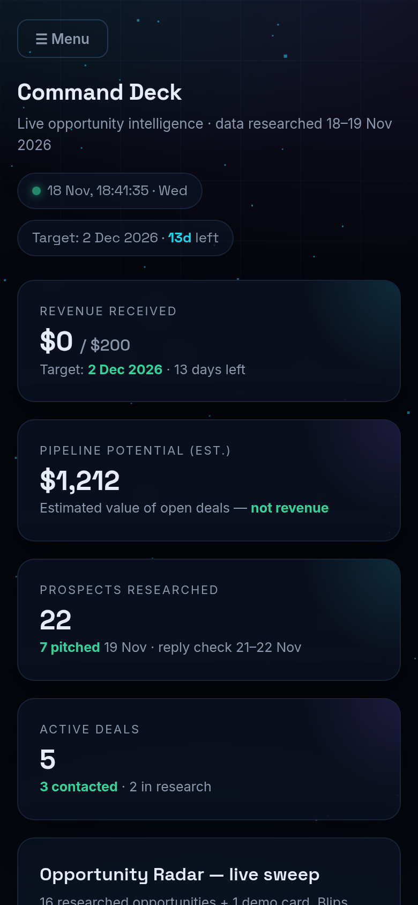

# HUNTORA

**Hunt Opportunities. Build Wealth.**

HUNTORA is a futuristic 2050-inspired command center for hunting money-making
opportunities across the global internet — freelance projects, website clients,
business leads, real-estate lead generation, bounties, remote jobs, commission
sales, affiliate offers, AI services, digital products, startups, and emerging
income trends.

It is a **complete, working static site** (no build step, no backend, no
framework). Open `index.html` or deploy it as-is to GitHub Pages or Vercel.



## Features

- **Command Deck** — live stats, animated radar preview, top opportunities,
  revenue snapshot, open tasks.
- **Opportunity Radar** — animated canvas radar sweep with clickable blips;
  filterable opportunity cards by category, search, and sort (probability /
  earning / fastest payment).
- **Opportunity Intelligence** — every card shows name, source, estimated
  earning, difficulty, competition, time to first payment, required skills,
  investment, location restrictions, a **probability score with transparent
  reasoning**, status, and next action.
- **AI Business Hunter** — type a niche or question; the app generates a
  structured research brief, a personalised pitch draft, and a 7-step execution
  plan from local templates and the real prospect database. Runs entirely
  client-side and is labelled **template-generated, not live AI**.
- **Client Discovery** — 22 real researched businesses (company, website,
  public contact, problem identified, pitch strategy, outreach status,
  follow-up date). Status changes and follow-up dates persist in localStorage.
- **Global Opportunity Map** — interactive SVG world map with region markers
  and opportunity counts; click a region to filter its clients.
- **Execution Center** — pipeline **Discovered → Researched → Contacted →
  Negotiating → Won → Paid** with drag-and-drop and click-to-advance, tasks
  with deadlines, follow-ups, and a pipeline-value chart. Persists locally.
- **Idea Laboratory** — score any idea on demand / competition / startup cost /
  profitability and get a GO / TEST / PARK verdict, plus 3 pre-loaded
  unconventional ideas with full evaluations.
- **Revenue Command Center** — real target **$200 actually received by
  2 Dec 2026**, actual revenue, pending payments, active deals, pipeline
  potential, daily rate needed, revenue by strategy, best-performing sources.

## Data honesty

The live data in HUNTORA is **real research, not fabricated**:

- **22 prospects** — 12 Western businesses with weak web presence and 10
  verified ad spenders, researched 18–19 Nov 2026 (sources noted on each row).
  Seven website pitches were sent on 19 Nov 2026; reply check is due 21–22 Nov.
- **16 researched opportunities** — from a broad scan of income lanes
  (PollPe, SproutGigs, JumpTask, HeyCash, Shaip, bounties, AI services, and
  more), each with a probability score and written reasoning.
- **Real-estate referral is shown honestly as blocked (2% probability)** —
  unlicensed referral fees are illegal in most US states and a RESPA §8 federal
  violation; only flat-fee appointment-setting is viable.
- **Revenue numbers are real: target $200 by 2 Dec 2026, actual received $0.**
- Exactly **one** demo opportunity card is included to show the card format;
  it is clearly badged **DEMO** and marked `researched: false` in
  `js/data.js`.

Source research files (in the author's workspace, not bundled):
`website-clients-research-2026-11-18.md`,
`ad-spenders-and-niches-2026-11-19.md`,
`new-opportunities-scan-2026-11-18.md`,
`real-estate-leadgen-research-2026-11-18.md`.

## Run locally

```bash
# any static server works; e.g. Python:
python3 -m http.server 8080
# then open http://localhost:8080
```

Or open `index.html` directly in a browser (ES modules require `http(s)://`
in some browsers, so the local server above is the reliable route).

## Deploy

See [DEPLOY.md](DEPLOY.md) — GitHub Pages (one push) and Vercel (one import),
both with zero configuration.

## Tech

- Vanilla JS (ES modules) + CSS — no framework, no build step.
- [Three.js](https://threejs.org) 0.160.0 via CDN — particle field + wireframe
  globe background (gracefully disabled if the CDN or WebGL is unavailable).
- Google Fonts: Space Grotesk (display) + Inter (body), with system fallbacks.
- Canvas radar sweep (`js/radar.js`), SVG world map (`js/map.js`), canvas
  charts (`js/charts.js`), data + persistence (`js/data.js`), app logic
  (`js/app.js`).

## Architecture — ready for real APIs later

All opportunity/prospect/deal/task data flows through `js/data.js`
(`META`, `PROSPECTS`, `OPPORTUNITIES`, `LAB_IDEAS`, `REGIONS`, and the
`store` localStorage wrapper). To go live, replace `loadStaticData()` with
fetchers in `js/data.js` and keep the same shapes:

- **Search APIs** — plug a business-search provider (e.g. Google Places,
  Apollo, Outscraper) into `PROSPECTS`; keep the `source` field honest.
- **AI agents** — replace the template-based Hunter in `js/app.js`
  (`runHunter()`) with a call to your AI endpoint; keep the
  "template-generated vs live AI" label truthful.
- **Email / CRM** — the Client Discovery table and Execution Center already
  model outreach status + follow-ups; wire the "Email" action to your
  provider and persist stages to a real backend instead of localStorage.
- **Payments** — `META.revenueReceived` must be updated from a real payment
  record (PayPal / Wise / Stripe), never by hand-editing the target.

## Screenshots

| Command Deck | Radar | Mobile |
|---|---|---|
|  |  |  |

## License

MIT — see [LICENSE](LICENSE).
